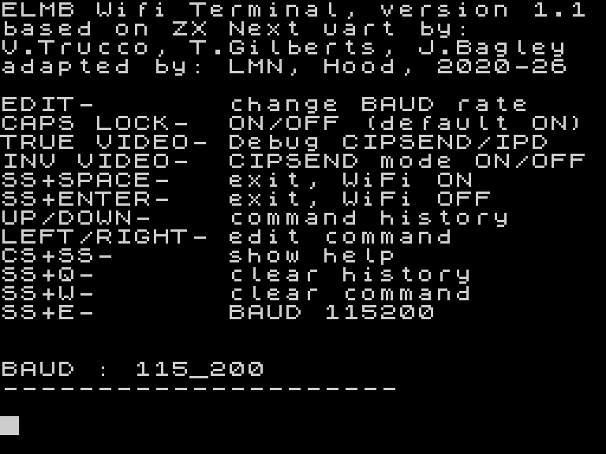

# WiFi Terminal

Current release: **1.1**, with separate `ver11/el-mb` and `ver11/zx-next` variants.

## What's New in 1.1

### Editing and command history

- Added: **1 KB command history**: UP/DOWN recalls a command directly into the editor for further changes.
- Added: LEFT/RIGHT cursor movement, insertion, and deletion on the edit line.
- Moved editing to the **bottom two screen rows**, leaving the upper 22 rows for UART output.
- Added: a scrolling viewport for long commands; Enter still sends the complete command.
- Improved cursor visibility and display updates, retaining ROM-based printing and compatible 32/64-column modes (64 mode for BSDOS only)

### Shortcuts

- **SS+W** clears the current command without sending it.
- **SS+Q** clears history after immediate Y/N confirmation, without Enter.
- **SS+E** sets the host UART to 115200 baud; it does not change the ESP baud setting.
- **CS+SS** displays the information/help screen again.
- **SS+SPACE** exits with WiFi left on. On EL/MB, **SS+ENTER** requests power-off; only MB can actually switch the module off.

### ZX Next version

- Added standalone and setup-component builds using the Next ESP UART and timing-dependent prescalers.
- EDIT cycles **15 supported rates**, from 2400 to 2000000 baud.
- ESP remains powered when exiting; the Next version does not offer the MB power-off shortcut.

Each variant provides a standalone TAP, a raw binary, and a component for WiFi Setup in `runable/`. Sources are in `source/`, tests in `tests/`, and `assembly.bat` builds both variants using SjASMPlus 1.20.3.

The original `ver10` archive is included unchanged, with its original documentation.

## Screenshot

WiFi Terminal 1.1 on EL/MB. Converted from the original SCR screen at 3x integer scale without smoothing.

## Downloads

Direct, version-specific links suitable for use on other websites:

| Platform / package | Download | Bytes |
|---|---|---:|
| EL/MB standalone TAP | [Terminal11_el_mb.tap](https://raw.githubusercontent.com/milan-stava/Wifi-terminal/v1.1/ver11/el-mb/runable/Terminal11_el_mb.tap) | 5411 |
| ZX Next standalone TAP | [Terminal11_next.tap](https://raw.githubusercontent.com/milan-stava/Wifi-terminal/v1.1/ver11/zx-next/runable/Terminal11_next.tap) | 5400 |
| EL/MB standalone BIN | [terminal11_el_mb.bin](https://raw.githubusercontent.com/milan-stava/Wifi-terminal/v1.1/ver11/el-mb/runable/terminal11_el_mb.bin) | 5325 |
| ZX Next standalone BIN | [terminal11_next.bin](https://raw.githubusercontent.com/milan-stava/Wifi-terminal/v1.1/ver11/zx-next/runable/terminal11_next.bin) | 5314 |
| EL/MB setup component | [terminal11_el_mb_setup.bin](https://raw.githubusercontent.com/milan-stava/Wifi-terminal/v1.1/ver11/el-mb/runable/terminal11_el_mb_setup.bin) | 5256 |
| ZX Next setup component | [terminal11_next_setup.bin](https://raw.githubusercontent.com/milan-stava/Wifi-terminal/v1.1/ver11/zx-next/runable/terminal11_next_setup.bin) | 5314 |

[Complete v1.1 package ZIP (sources and binaries)](https://github.com/milan-stava/Wifi-terminal/archive/refs/tags/v1.1.zip).

The links target the existing release tag, so later development on main does not change these downloads.